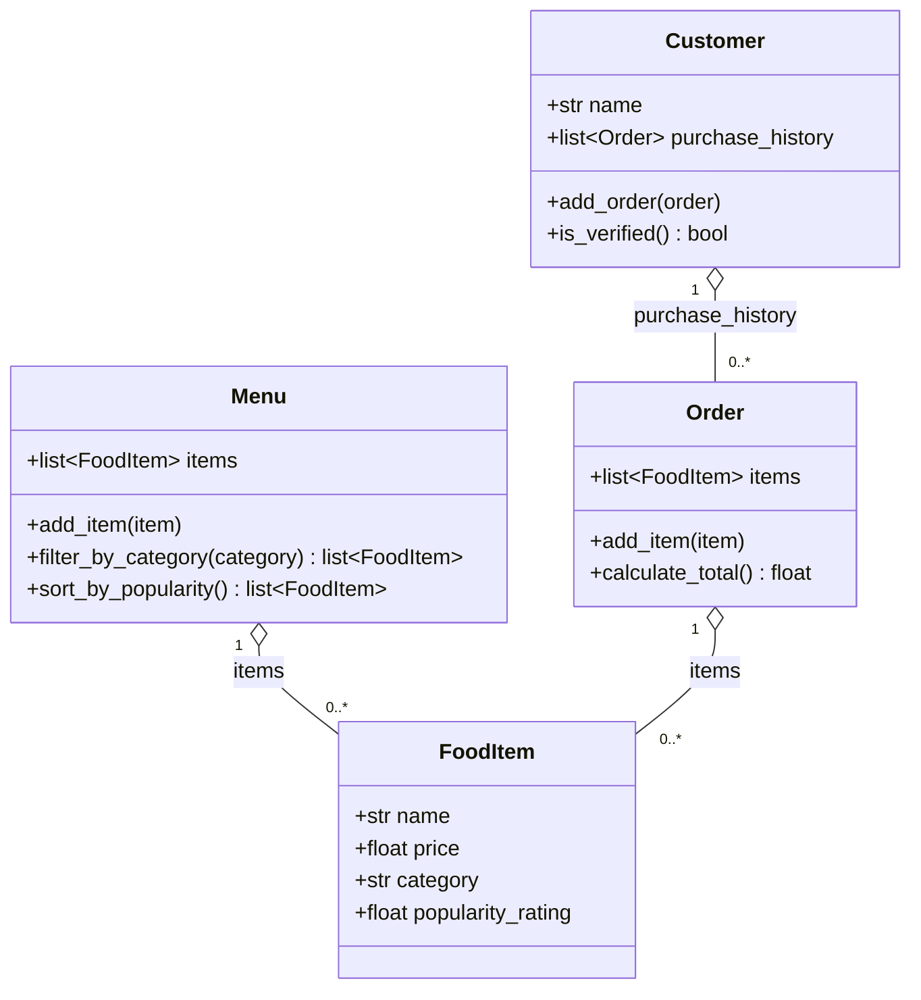

# ByteBites: Final UML Design

Verified against `bytebites_spec.md`. Four classes, connected by composition.

## What each class is (one sentence each)

- **Customer**: a person using the app, identified by name, with a list of their past orders.
- **FoodItem**: one item we sell, with a name, price, category, and popularity rating.
- **Menu**: the full list of food items, which can be filtered by category and sorted.
- **Order**: one transaction that holds the items a customer picked and adds up the cost.

## How each attribute traces back to the spec

| Spec says | Where it lives |
|---|---|
| "tracking their names" | `Customer.name` |
| "past purchase history" | `Customer.purchase_history` |
| "so the system can verify they are real users" | `Customer.is_verified()` (True once they have at least one past order) |
| "name, price, category, and popularity rating" | `FoodItem` attributes |
| "a digital list that holds all items" | `Menu.items` |
| "filter by category such as Drinks or Desserts" | `Menu.filter_by_category()` |
| "store the selected items" | `Order.items` |
| "compute the total cost" | `Order.calculate_total()` |

`sort_by_popularity()` is not in the client request. It comes from the lab instructions (Part 3
asks for sorting), and popularity is the only rating the spec gives us to sort by.

## Comparing this to the first draft

The first draft (`draft_from_copilot.md`) had 12 classes, login logic, inheritance trees, and a
recommendation engine. With the reference file attached, the assistant had hard limits: four
classes, composition only, no auth, nothing outside the spec. That cut the design down to what the
client actually asked for.

Two judgment calls were still mine to make:

- **No `customer` field on `Order`.** It is tempting to add a back reference, but the spec only
  says a customer has a history of orders. An order does not need to know its owner to compute a
  total.
- **What "verify they are real users" means.** The spec does not define it, so `is_verified()`
  uses the only evidence it gives: a customer with at least one past order is real.

The difference between the two drafts was not the model getting smarter. Without ground rules, the
first chat had to guess what a "food ordering app" usually includes, and it guessed big. The
reference file took the guessing away.
