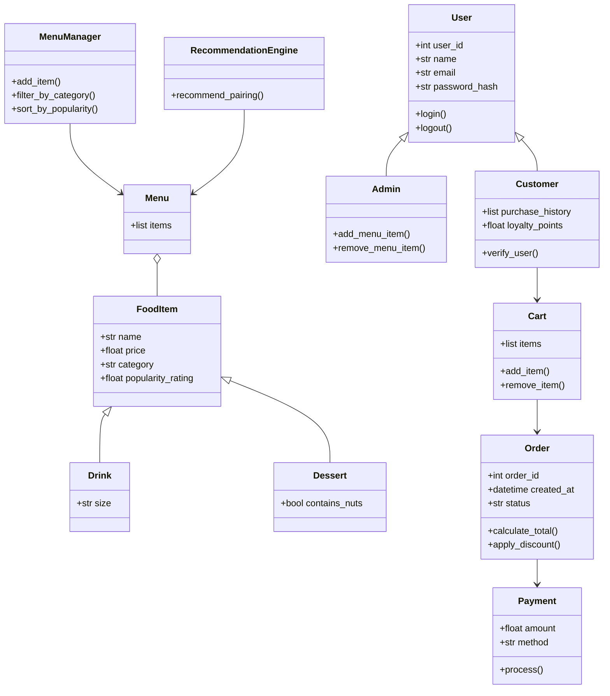

# ByteBites: First Draft UML (no reference file)

First-pass diagram from an unconstrained prompt: only `bytebites_spec.md` as context and
"Generate a UML class diagram for the ByteBites backend." No ground rules. Kept for comparison
only. Do not build from this.

## Problems with this draft

- **12 classes instead of 4.** `User`, `Admin`, `Drink`, `Dessert`, `MenuManager`, `Cart`,
  `Payment`, and `RecommendationEngine` are not in the feature request.
- **Authentication crept in** (`email`, `password_hash`, `login()`, `logout()`). The reference
  file explicitly rules this out.
- **Inheritance where none is needed.** Drinks and desserts are just a `category` value on a
  `FoodItem`. Making them subclasses means a new class every time the menu adds a category.
- **`MenuManager` duplicates `Menu`.** The spec says the collection itself does the filtering.
- **`Cart` and `Order` overlap.** The spec describes one object that holds picked items and
  computes the total. That is `Order`.
- **Extra attributes nobody asked for:** `loyalty_points`, `status`, `created_at`,
  `apply_discount()`, `size`, `contains_nuts`.
- **`RecommendationEngine`** is the feature that suggested soup as dessert. Not in scope.
